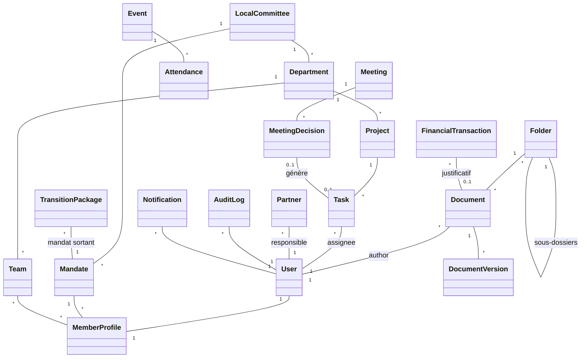
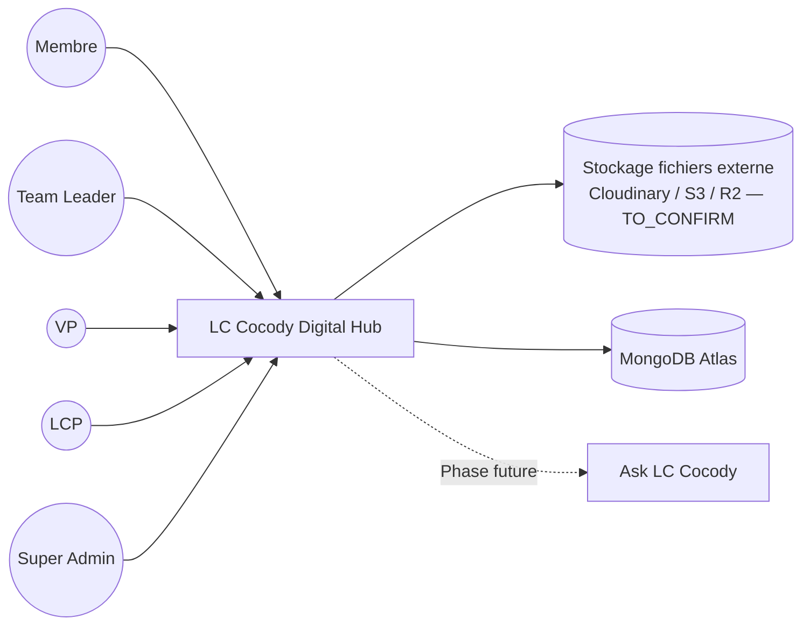
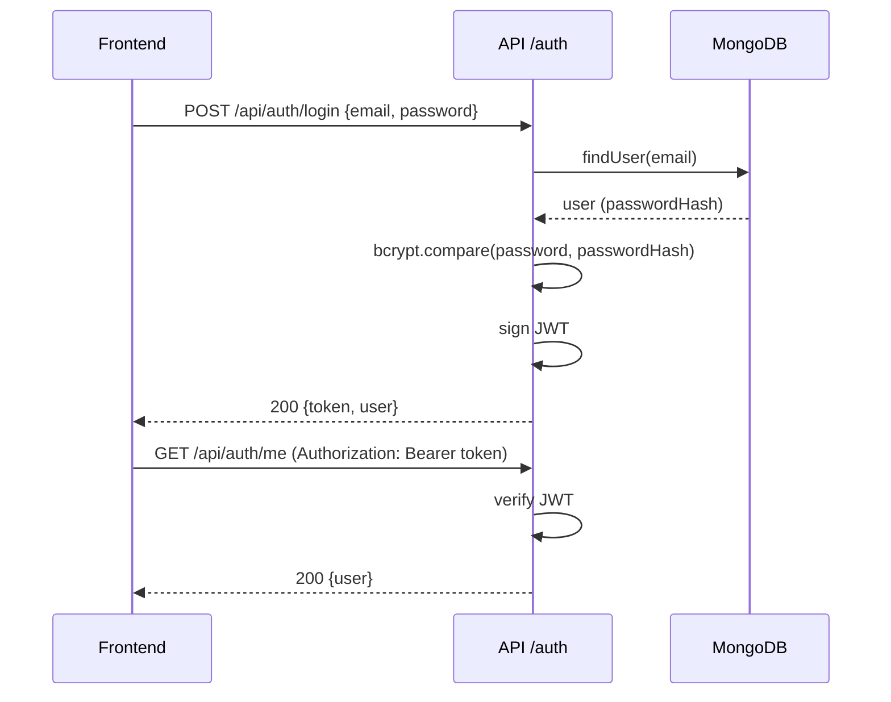
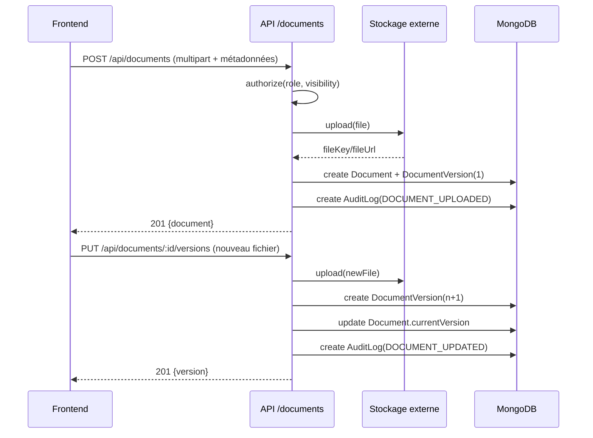
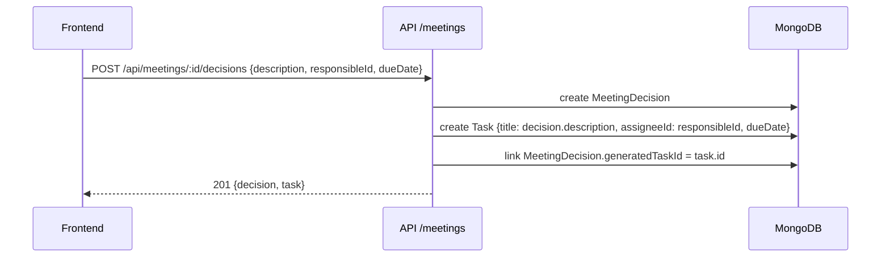

# PHASE 0 — ANALYSE ET ARCHITECTURE

> Document produit rétroactivement après le scaffolding de la Phase 1 (voir
> [ARCHITECTURE_DECISIONS.md](ARCHITECTURE_DECISIONS.md), décision « Passage direct au scaffolding »).
> Il complète cette décision et sert désormais de référence pour les phases suivantes.
> Statut : conforme à `instruction.md` / `PROJECT_CONTEXT.md`. Aucune règle AIESEC ou processus officiel
> n'est inventé ici — tout point non confirmé est marqué **TO_CONFIRM** ou **CONFIGURABLE**.

---

## 1. Architecture globale

```text
┌─────────────────────┐        HTTPS/JSON        ┌──────────────────────┐
│   Frontend (SPA)     │ ───────────────────────▶ │   Backend (API REST) │
│  React + Vite + TS   │ ◀─────────────────────── │  Express + TS        │
└─────────────────────┘                            └──────────┬────────────┘
                                                                │ Prisma
                                                                ▼
                                                     ┌──────────────────────┐
                                                     │   MongoDB (Atlas)     │
                                                     └──────────────────────┘

Backend ──▶ Stockage fichiers externe (Cloudinary / S3 / Cloudflare R2 — TO_CONFIRM)
Backend ──▶ (Phase future) Ask LC Cocody — assistant IA sur les documents autorisés
```

- Authentification : JWT (access token), hashage bcrypt/bcryptjs.
- Autorisation : contrôlée côté backend uniquement (RG-02) — le frontend n'est jamais une couche de sécurité.
- Fichiers binaires : jamais stockés dans MongoDB, uniquement métadonnées + référence externe (§11 PROJECT_CONTEXT.md).
- IA : hors périmètre MVP, architecture pensée pour accueillir plus tard **Ask LC Cocody** (recherche documentaire avec sources, respect des permissions).

## 2. Architecture backend

Déjà scaffoldée en Phase 1 (`backend/src/`) :

```text
Route → Middleware (auth, validation) → Controller → Service (logique métier) → Repository/Prisma → MongoDB
```

- `config/` : env (Zod), CORS, Prisma client singleton.
- `middlewares/` : gestion d'erreurs, (à venir Phase 3/4) `authenticate`, `authorize(roles)`.
- `validators/` : schémas Zod par module, réutilisés controller + éventuellement frontend (types partagés TO_CONFIRM si monorepo de types nécessaire).
- `services/` : logique métier pure, testable indépendamment d'Express.
- `repositories/` : accès Prisma isolé (facilite les tests et un futur changement de couche de persistance).

## 3. Architecture frontend

Déjà scaffoldée en Phase 1 (`frontend/src/`), organisation par fonctionnalité :

```text
features/<module>/  → composants, hooks et services spécifiques au module (auth, members, documents, ...)
components/         → composants UI partagés
layouts/, pages/     → structure de navigation (React Router)
services/            → client API (axios) + appels par ressource
store/               → état global (Zustand) — session utilisateur, préférences UI
hooks/               → hooks partagés (ex. useApiHealth)
```

- TanStack Query pour la synchronisation des données serveur (cache, invalidation).
- Zustand réservé à l'état réellement global (session, thème), pas comme remplaçant de TanStack Query.
- React Hook Form + Zod pour tous les formulaires (validation partagée avec le pattern backend).

## 4. Modèle de données

Entités fondamentales imposées par `PROJECT_CONTEXT.md` §8. Relations proposées ci-dessous ;
tout champ marqué **TO_CONFIRM** doit être validé avant implémentation détaillée en Phase 2+.

### 4.1 Organisation

| Entité | Champs clés | Relations |
|---|---|---|
| `User` | email, passwordHash, role, isActive | 1-1 `MemberProfile` |
| `LocalCommittee` | name, config (départements actifs, etc.) | 1-N `Department`, 1-N `Mandate` |
| `Department` | name, description, isActive | N-1 `LocalCommittee` ; 1-N `Team`, `Project`, `Event`, `Meeting` — **CONFIGURABLE** (RG-09 : jamais de liste figée en dur) |
| `Team` | name | N-1 `Department` ; N-1 `Mandate` ; N-N `MemberProfile` |
| `Mandate` | label (ex. "2025-2026"), startDate, endDate, status | 1-N sur quasi toutes les entités « activité » (traçabilité RG-08) |
| `MemberProfile` | firstName, lastName, phone, position | 1-1 `User` ; N-1 `Department`, `Team`, `Mandate` (mandat courant) |

### 4.2 Documents

| Entité | Champs clés | Relations |
|---|---|---|
| `Folder` | name, visibility | self-relation (`parentFolderId`) ; N-1 `Department` (optionnel) ; N-1 `User` (owner) |
| `Document` | name, fileKey/fileUrl, mimeType, size, visibility, tags[], category | N-1 `Folder` ; N-1 `User` (author) ; N-1 `Mandate` ; 1-N `DocumentVersion` |
| `DocumentVersion` | versionNumber, fileKey/fileUrl, changeNote | N-1 `Document` ; N-1 `User` (uploadedBy) |

`visibility` : `PUBLIC \| INTERNAL \| DEPARTMENT \| CONFIDENTIAL \| RESTRICTED` (RG imposée, §Phase 6).

### 4.3 Activités

| Entité | Champs clés | Relations |
|---|---|---|
| `Project` | name, description, status | N-1 `Department` ; N-1 `Mandate` ; N-1 `User` (owner) ; 1-N `Task` |
| `Task` | title, status, priority, dueDate | N-1 `Project` (optionnel — tâche indépendante possible, **TO_CONFIRM**) ; N-1 `User` (assignee) |
| `Event` | title, startDate, endDate, location | N-1 `Department` ; N-1 `Mandate` ; N-1 `User` (organizer) ; 1-N `Attendance` |
| `Attendance` | status (PRESENT/ABSENT/EXCUSED) | N-1 `Event` ; N-1 `User` |
| `Meeting` | title, date, agenda, minutes | N-1 `Department` ; N-1 `Mandate` ; 1-N `MeetingDecision` |
| `MeetingDecision` | description, dueDate | N-1 `Meeting` ; N-1 `User` (responsible) ; 1-1 `Task` optionnelle générée (workflow Phase 9) |

`Task.status` : `TODO \| IN_PROGRESS \| DONE \| OVERDUE`. `Task.priority` : `LOW \| MEDIUM \| HIGH \| URGENT`.

### 4.4 Finance, partenaires, pilotage

| Entité | Champs clés | Relations |
|---|---|---|
| `FinancialTransaction` | type (INCOME/EXPENSE), amount, category, date | N-1 `Department` ; N-1 `Mandate` ; N-1 `Document` (justificatif, optionnel) ; N-1 `User` (recordedBy) |
| `Partner` | name, status, contact* | N-1 `User` (responsible) ; N-1 `Mandate` |
| `KPI` | name, target, currentValue, unit, period | N-1 `Department` (optionnel) ; N-1 `Mandate` |
| `Report` | title, type (MONTHLY/DEPARTMENTAL/MANDATE), period | N-1 `Department` (optionnel) ; N-1 `Mandate` ; N-1 `User` (author) ; N-1 `Document` (fichier généré, optionnel) |

`Partner.status` : `PROSPECT \| CONTACTED \| MEETING \| NEGOTIATION \| PARTNER \| LOST`.

### 4.5 Connaissance, notifications, audit, transition

| Entité | Champs clés | Relations |
|---|---|---|
| `KnowledgeArticle` | title, content, category, tags[], visibility | N-1 `User` (author) |
| `Notification` | type, message, isRead | N-1 `User` ; référence polymorphe (`relatedEntityType` + `relatedEntityId`) vers l'entité source |
| `AuditLog` | action, entityType, entityId, metadata | N-1 `User` ; **immuable** (RG-06 — non modifiable par un utilisateur standard) |
| `TransitionPackage` | status, recommendations | N-1 `Mandate` (sortant) ; référence N-1 `Mandate` (suivant, optionnel) ; agrège par référence : `Document[]`, `Report[]`, `KPI[]`, `Project[]`, `FinancialTransaction[]` (résumé), `Partner[]`, `KnowledgeArticle[]` |

`LessonLearned` (Phase 16) : **TO_CONFIRM** — non listée comme entité de premier niveau dans
`PROJECT_CONTEXT.md` §8. Modélisée par défaut comme sous-document embarqué sur `Project`
(`whatWorked`, `whatDidntWork`, `difficulties`, `recommendations`, `lessons`), à transformer en
collection indépendante si le besoin de recherche/filtrage transverse est confirmé en Phase 16.

### 4.6 Diagramme de classes (simplifié)



## 5. Diagramme de contexte



## 6. Rôles et permissions (matrice de principe)

| Rôle | Portée | Principe |
|---|---|---|
| `SUPER_ADMIN` | Toute la plateforme | Accès total, gestion des utilisateurs et de la configuration (départements, mandats) |
| `LCP` | Local Committee President | Vision transverse sur tous les départements, validation transition, rapports de mandat |
| `VP` | Son département | Gestion complète de son département (équipes, projets, budget départemental, documents `DEPARTMENT`) |
| `TEAM_LEADER` | Son équipe | Gestion des tâches/membres de son équipe, documents de son périmètre |
| `MEMBER` | Lui-même + contenu `PUBLIC`/`INTERNAL` | Consultation, exécution de ses tâches, upload dans son périmètre autorisé |

Le détail fin (matrice action × module × rôle) sera implémenté et testé Phase 4 — RBAC ; le backend
reste la seule autorité de décision (RG-02). Toute règle non explicitement confirmée par le
responsable du LC est **TO_CONFIRM** avant mise en production.

## 7. Cas d'utilisation principaux

- S'authentifier / se déconnecter / changer son mot de passe (tous rôles).
- Créer/consulter/mettre à jour un membre, un département, une équipe, un mandat (rôles habilités).
- Déposer un document, le classer, le rechercher, le télécharger, créer une nouvelle version (rôles habilités selon visibilité).
- Créer un projet, y rattacher des tâches, suivre leur statut (Kanban).
- Planifier un événement, gérer la présence.
- Tenir une réunion, consigner des décisions, générer une tâche à partir d'une décision.
- Enregistrer une transaction financière avec justificatif.
- Suivre un partenaire à travers le pipeline CRM.
- Définir des KPIs, générer des rapports.
- Consulter/rédiger un article de la base de connaissances.
- Recevoir des notifications (tâches, échéances, documents, événements).
- Constituer un package de transition en fin de mandat.

## 8. Diagrammes de séquence principaux

### 8.1 Authentification



### 8.2 Upload de document + versioning



### 8.3 Réunion → décision → tâche (workflow explicite instruction.md Phase 9)



## 9. API principales (aperçu par module)

Toutes les routes sont préfixées `/api`. Détail complet défini au fil de chaque phase.

```text
/auth            register, login, me, logout, change-password         (Phase 3)
/users           CRUD + pagination/recherche/filtres                   (Phase 5)
/members          idem (MemberProfile)                                 (Phase 5)
/departments      CRUD (configurable, RG-09)                           (Phase 5)
/teams            CRUD                                                 (Phase 5)
/mandates         CRUD                                                 (Phase 5)
/folders /documents  CRUD + upload + versions + recherche              (Phase 6)
/dashboard        agrégats par rôle                                    (Phase 7)
/projects /tasks  CRUD + Kanban                                        (Phase 8)
/events /meetings CRUD + attendance + decisions                        (Phase 9)
/finance          CRUD transactions                                    (Phase 10)
/partners         CRUD + pipeline                                      (Phase 11)
/kpis /reports    CRUD                                                 (Phase 12)
/notifications    liste, marquage lu                                   (Phase 13)
/audit-logs       lecture seule (sauf Super Admin)                     (Phase 14)
/knowledge        CRUD articles                                        (Phase 15)
/transition       package + checklist                                  (Phase 17)
```

## 10. Risques techniques identifiés

| Risque | Impact | Mitigation |
|---|---|---|
| Prisma + MongoDB exige un **replica set** (même en local) pour les transactions | Bloquant en dev/test si non anticipé | Documenté dès Phase 2 ; script de démarrage MongoDB local en mode `--replSet` pour les tests |
| Choix du stockage externe (Cloudinary/S3/R2) non tranché | Retarde Phase 6 | Rester TO_CONFIRM, concevoir la couche d'accès aux fichiers derrière une interface (`services/storage`) pour permettre de changer de fournisseur sans impacter le reste du code |
| Modèle de permissions fin (rôle × département × visibilité document) | Complexité RBAC (Phase 4/6) | Construire une matrice de permissions testée unitairement avant intégration UI |
| Volume de versions de documents dans le temps | Coût de stockage/perf | Pagination + index sur `documentId` dès la conception du schéma (Phase 2/6) |
| `TransitionPackage` agrège de nombreuses entités | Risque de requêtes lourdes | Agrégation par référence (pas de duplication), génération à la demande plutôt qu'en temps réel |
| Absence de processus AIESEC officiel documenté | Risque d'inventer des règles métier | Toute règle non confirmée reste `TO_CONFIRM` (RG projet, §14 instruction.md) |

## 11. Plan de développement par phases

Le plan est déjà fixé par `instruction.md` (Phases 0 à 21) et reporté dans
[PROJECT_STATUS.md](PROJECT_STATUS.md), qui fait foi pour le suivi d'avancement réel.

## 12. Critères de validation par phase (rappel synthétique)

Chaque phase n'est validée que si, cumulativement :

```text
CODE ✓          — implémenté selon l'architecture ci-dessus
BUILD ✓         — compile sans erreur (tsc, vite build)
TEST ✓          — tests correspondants passent (unitaires/intégration selon la phase)
SECURITY ✓      — pas de secret exposé, permissions vérifiées côté backend
INTEGRATION ✓   — n'introduit pas de régression sur les phases précédentes
DOCUMENTATION ✓ — PROJECT_STATUS.md et, si pertinent, ARCHITECTURE_DECISIONS.md mis à jour
```

Un rapport de phase (format §4 `instruction.md`) est produit à la fin de chaque phase, avec état
`READY FOR VALIDATION`.
